# Sistema Hotel

Gestão de hóspedes de um hotel: cadastro, reservas, check-in e checkout com cálculo da conta.

Backend em Python com Django. BD PostgreSQL. Frontend em React com TypeScript. Subindo no Docker, cada um container para cada módulo (back, front e banco)

## Como rodar

Requisitos:

- Git
- Docker
- Portas 8080 (sistema) e 5432 (banco) livres

```bash
git clone https://github.com/felipeaugustus/SistemaHotel.git
cd SistemaHotel
docker compose up -d --build --wait
```

Abra http://localhost:8080 e entre com:

- Usuário: `atendente`
- Senha: `atendente123`

Também dá para criar uma conta nova pelo botão **Criar conta**.

Para parar:

```bash
docker compose down
```

Os dados ficam salvos no volume do banco. Para apagar tudo, use `docker compose down -v`.

As variáveis já têm valor padrão, então não precisa de `.env`. Para trocar alguma (senha do banco, chave do Django, usuário inicial), copie o `.env.example` para `.env` e edite.

## Rodar em modo de desenvolvimento

Precisa de Docker, [uv](https://docs.astral.sh/uv/) e Node 22.12 ou mais novo.

Banco:

```bash
docker compose up -d --wait db
```

Backend, em um terminal:

```bash
cd backend
uv sync
uv run python manage.py migrate
uv run python manage.py seed
uv run python manage.py runserver 8000
```

Frontend, em outro terminal:

```bash
cd frontend
npm install
npm run dev
```

Abra http://localhost:5173. O Vite repassa `/api`, `/o` e `/accounts` para o Django.

## Testes

Backend (precisa do banco rodando):

```bash
cd backend
uv run pytest
```

Frontend:

```bash
cd frontend
npm test
```

---

## Sobre o sistema

O atendente entra no sistema, cadastra os hóspedes, cria as reservas e faz o check-in e o checkout. No checkout aparece a conta detalhada, com cada diária, o estacionamento e a multa de atraso, se tiver.

### Regras

Explicação de alguns detalhes na regra de negócio:

- O check-in antes das 14h do dia da reserva é bloqueado, e o sistema mostra o alerta.
- O período da reserva é sempre cobrado inteiro, mesmo se o hóspede sair antes. Se ele ficar além da data de saída, ele é cobrado pelas diárias extras.
- O checkout vai até 12:00. Depois disso, entra uma multa de 50% da diária do dia do checkout. A multa não inclui o estacionamento.
- Quem sai antes da data prevista não paga multa, mesmo depois das 12h, porque a diária daquele dia já está paga.
- A conta não fica gravada no banco. Ela é recalculada a partir das datas da reserva e do horário do checkout.
- Os horários usam o fuso de São Paulo, independente do fuso do servidor.

### Autenticação

OAuth 2.0 com o fluxo Authorization Code + PKCE, com o [django-oauth-toolkit](https://django-oauth-toolkit.readthedocs.io/). O próprio Django é o servidor de autorização.

- A tela de login e a de cadastro ficam no Django. O React nunca recebe a senha, só o token.
- As senhas são guardadas com hash Argon2.
- O access token dura 1 hora. Quando expira, o frontend usa o refresh token para pegar outro sem pedir login.
- No "Sair", o frontend revoga o token, e o próximo login sempre pede a senha de novo.

Qualquer pessoa consegue criar uma conta. Para o teste deixei assim, mas num sistema real eu restringiria o cadastro (por convite ou com aprovação no admin).

### Organização do projeto

```text
SistemaHotel/
├── docker-compose.yml      # db, backend e frontend
├── backend/
│   ├── config/             # settings e rotas do Django
│   └── apps/
│       ├── accounts/       # login, cadastro e o comando seed
│       ├── guests/         # hóspedes
│       └── reservations/
│           ├── rules.py    # regras de cobrança e horário, funções puras
│           ├── services.py # check-in e checkout
│           └── views.py    # API
└── frontend/
    ├── nginx.conf          # serve o React e repassa a API para o Django
    └── src/
        ├── auth/           # PKCE, login, logout e tokens
        ├── api/            # chamadas para a API
        ├── components/     # formulários, tabela da conta, diálogo de checkout
        └── pages/          # Recepção, Hóspedes, Login e Callback
```

No backend separei as responsabilidades em camadas:

- **`rules.py`:** as regras de negócio puras.
- **`services.py`:** aplica as regras nas reservas, com a mudança de status e o horário real.
- **`views.py`:** expõe os serviços pela API.

No frontend, cada página busca os próprios dados, e as chamadas ficam concentradas em `api/`. O cliente da API coloca o token em todas as requisições e renova o token quando a API responde 401.

No Docker, o nginx serve o React e repassa `/api`, `/o`, `/accounts` e `/admin` para o Django. Tudo fica na mesma origem, sem precisar de CORS. Ao subir, o backend aplica as migrations e cria o usuário `atendente`.

### Testes

- **Backend:** as regras de cobrança, os limites de horário (11:59, 12:00, 12:01, 13:59, 14:00), o check-in, o checkout, a API, o fluxo OAuth com PKCE e o cadastro.
- **Frontend:** o PKCE, o login, o refresh do token, as rotas protegidas, o alerta de check-in, a conta detalhada e os formulários. As respostas da API são simuladas com MSW.

## Telas

### Tela inicial

Entrar ou criar uma conta.

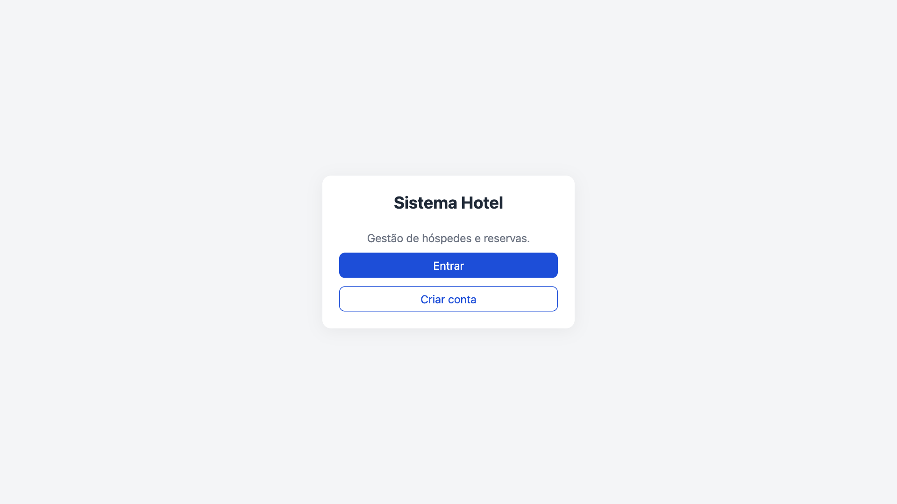

### Login

Fica no Django. Depois do login, volta para o sistema com o token.

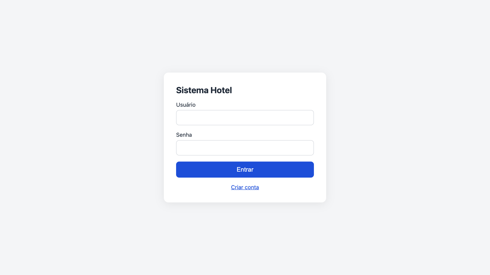

### Criar conta

A senha passa pelas validações do Django. Depois de criar a conta, a pessoa já entra logada.

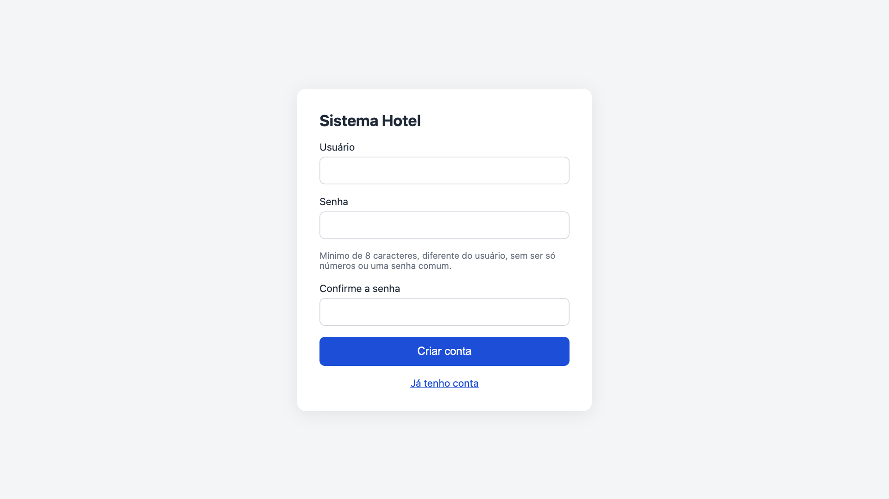

### Recepção: aguardando check-in

Hóspedes que têm reserva mas ainda não fizeram o check-in.

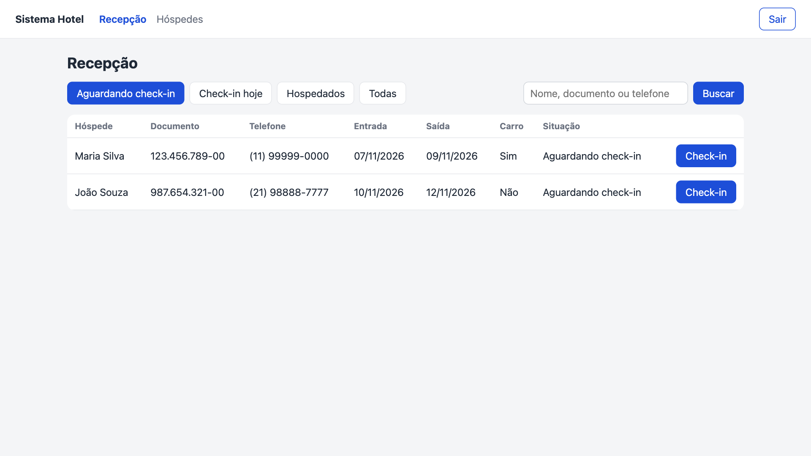

### Recepção: check-in hoje

Reservas com entrada prevista para hoje.

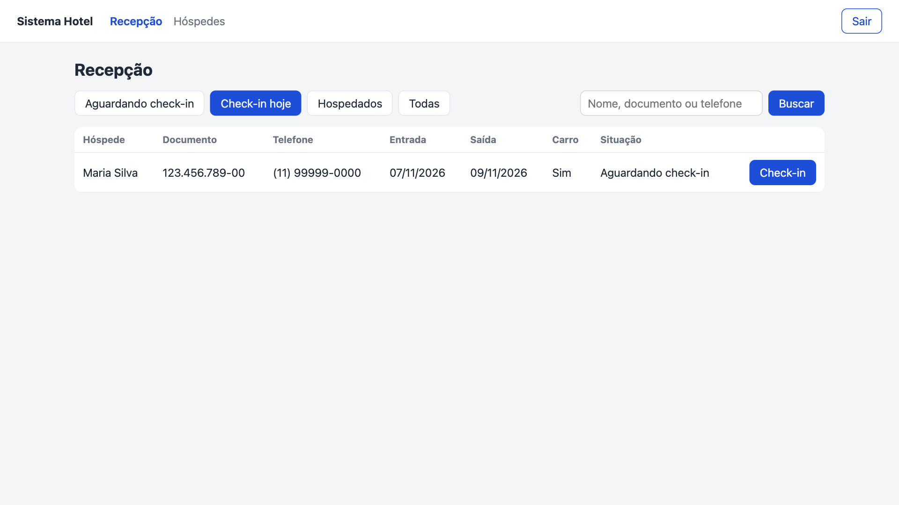

### Check-in antes das 14h

O sistema bloqueia e mostra o alerta.

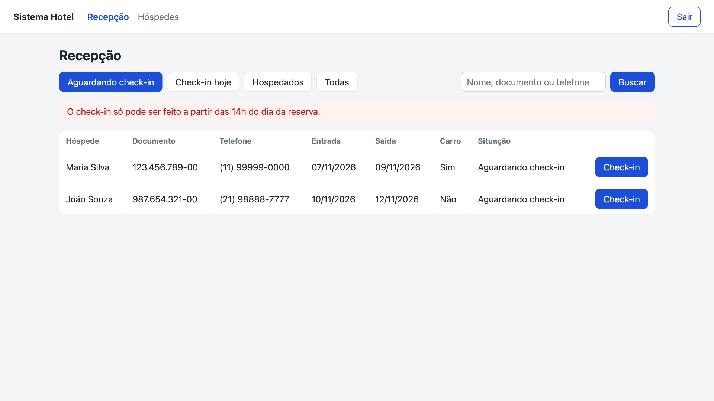

### Recepção: hospedados

Hóspedes que ainda estão no hotel.

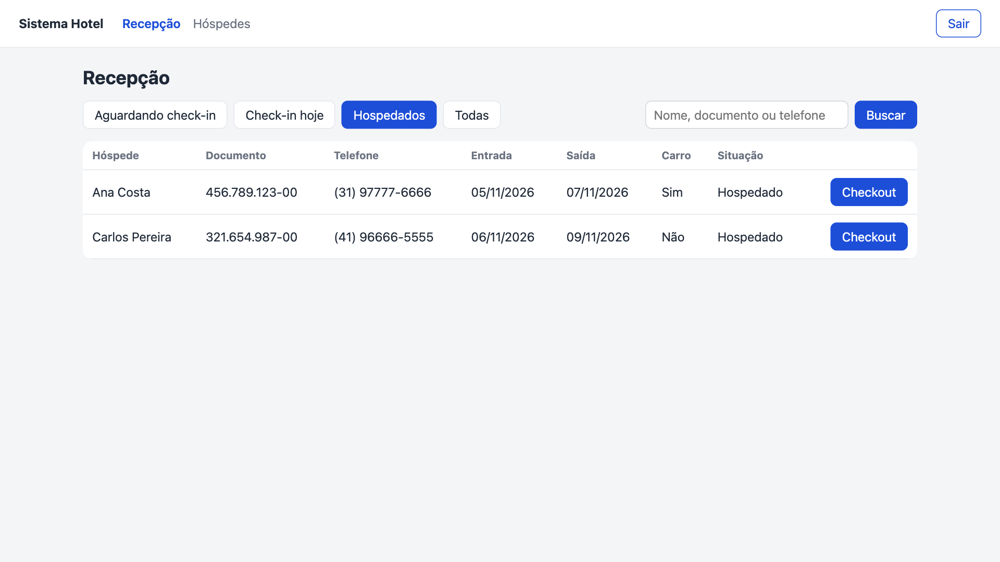

### Checkout

A conta detalhada antes de confirmar. Neste exemplo, a reserva da Ana era de quinta a sábado, com carro, e ela saiu no sábado depois das 12h: duas diárias de dia útil com estacionamento (R$ 270) mais a multa de sábado (R$ 90).

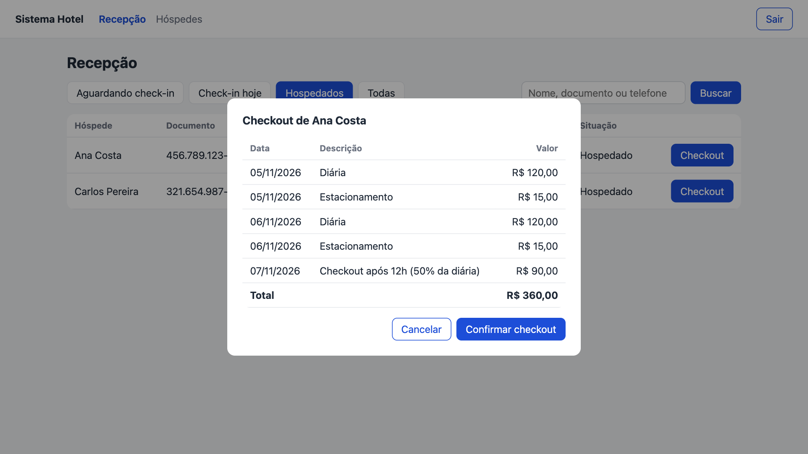

### Checkout concluído

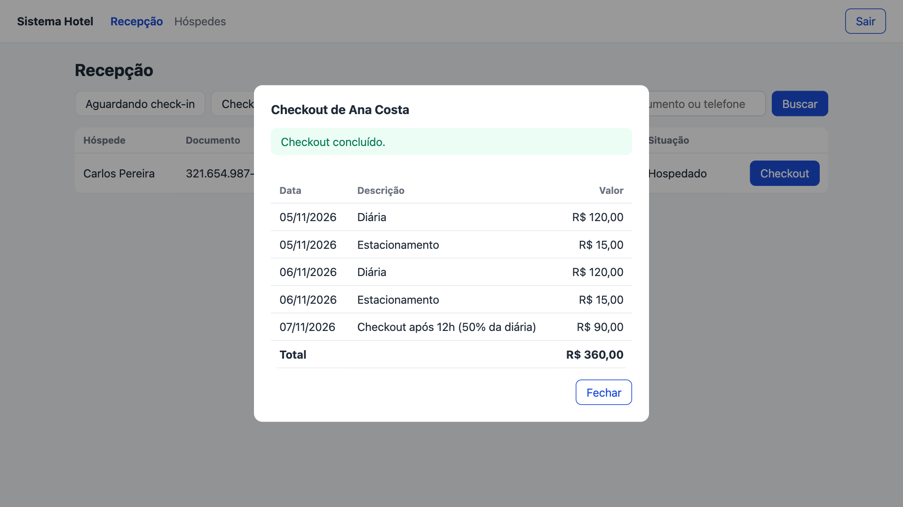

### Hóspedes

Busca por nome, documento ou telefone, e cadastro de hóspede.

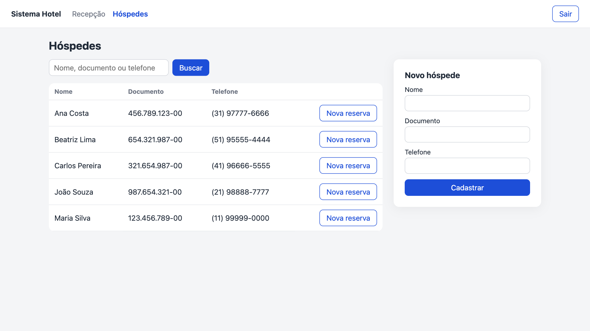

### Documento já cadastrado

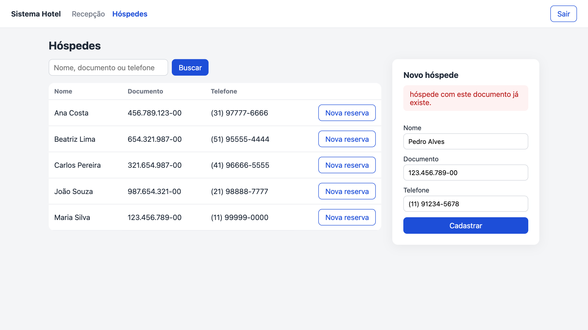

### Nova reserva

Pelo botão **Nova reserva** na linha do hóspede.

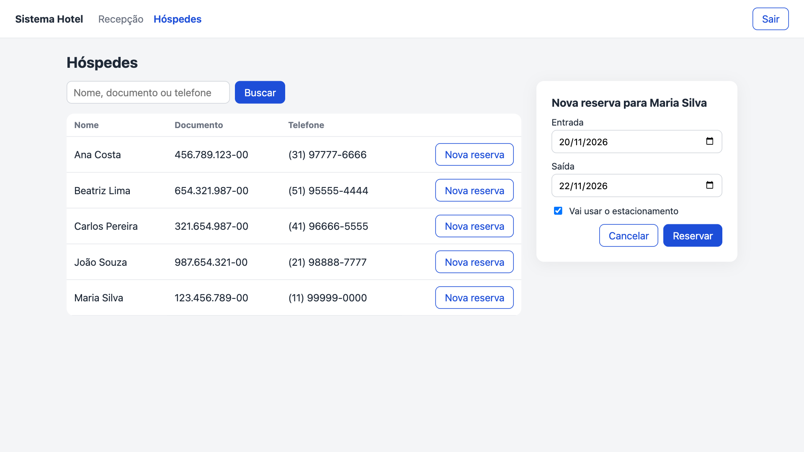
